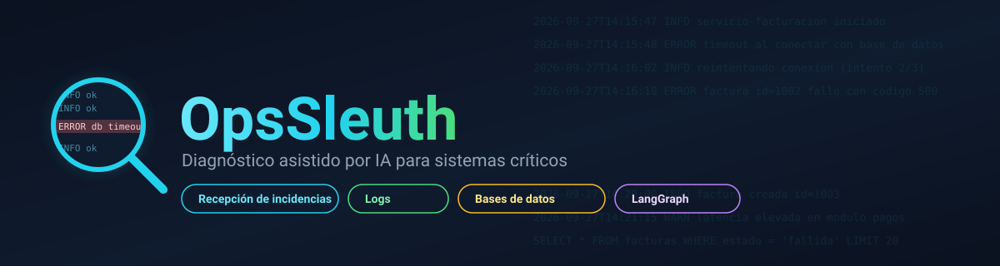

# OpsSleuth

  

**OpsSleuth** es una herramienta de diagnóstico para sistemas críticos: reduce el
tiempo de investigación de errores conversando con quien reporta la incidencia,
formulando las preguntas justas para completar el contexto, y luego saliendo a
buscar evidencia real por su cuenta — en archivos de logs y en bases de datos —
en vez de quedarse solo con lo que la persona recuerda.

No es un chatbot que "adivina" causas: cada apreciación que produce está anclada
a evidencia que un agente basado en [LangGraph](https://langchain-ai.github.io/langgraph/)
efectivamente leyó con sus herramientas — nunca a texto libre inventado por el
modelo. Si no encuentra nada, lo dice explícitamente.

## Por dónde empezar

-   :material-rocket-launch:{ .lg .middle } **Primeros pasos**

    ---

    Instala dependencias con `uv`, configura un proveedor de modelo (Claude,
    Gemini u Ollama local) y ejecuta la CLI en minutos.

    [:octicons-arrow-right-24: Primeros pasos](getting-started.md)

-   :material-sitemap:{ .lg .middle } **Arquitectura**

    ---

    Cómo se organizan los módulos (`domain`, `clarification`, `evidence`,
    `database`, `llm`, `presentation`), y qué principios de diseño son
    innegociables en este proyecto.

    [:octicons-arrow-right-24: Arquitectura](architecture.md)

-   :material-graph-outline:{ .lg .middle } **Flujo del agente**

    ---

    El grafo de LangGraph que ejecuta cada búsqueda de evidencia: cómo decide
    cuándo llamar a una herramienta, cuándo preguntar al usuario, y cuándo
    concluir.

    [:octicons-arrow-right-24: Flujo del agente](agent-workflow.md)

-   :material-book-open-page-variant:{ .lg .middle } **Referencia de código**

    ---

    Documentación generada automáticamente a partir de los docstrings
    (numpydoc) de cada módulo — siempre sincronizada con el código fuente.

    [:octicons-arrow-right-24: Referencia](reference/index.md)

## Qué hace hoy

OpsSleuth conversa contigo caso por caso. Cada caso pasa por hasta tres fases,
la primera obligatoria y las otras dos activadas automáticamente cuando hay una
fuente disponible:

1. **Recepción de la incidencia** — captura la descripción libre del problema,
   identifica si falta el sistema afectado, el síntoma o el momento en que
   ocurrió, y pregunta solo lo que realmente falta (una por una, o todo junto
   si prefieres responder de una vez). Detecta contradicciones con lo ya dicho
   sin descartar ningún dato, y te avisa si parece que describes más de un
   problema a la vez.
2. **Búsqueda de evidencia en logs** — en cuanto la descripción queda
   completa, te invita a aportar una ruta de archivo o pegar contenido
   directamente. Un agente localiza las entradas relacionadas con el
   incidente (aislando por horario cuando lo conoces) sin cargar el archivo
   completo en el contexto del modelo, y consolida lo encontrado en una única
   apreciación.
3. **Consulta a bases de datos** — si hay una base de datos configurada
   (`OPSSLEUTH_DB_URL`), un segundo agente inspecciona el esquema y construye
   consultas `SELECT` de solo lectura — incluso con cruces entre varias
   tablas — para correlacionar el incidente con el estado real de los datos,
   siempre dentro de una barandilla de seguridad que valida cada consulta
   antes de ejecutarla.

Ambos agentes de búsqueda comparten la misma forma de grafo (ver
[Flujo del agente](agent-workflow.md)) y el mismo mecanismo de
intercambiabilidad de proveedor de modelo: un único `BaseChatModel` de
LangChain, construido una sola vez por
[`crear_modelo_chat()`](reference/llm.md).

## Principios que gobiernan el proyecto

Este proyecto se desarrolla siguiendo [Spec Kit](https://github.com/) (specs
en `specs/`) y una constitución propia
(`.specify/memory/constitution.md`) con cuatro principios no negociables:
cumplimiento SOLID, arquitectura modular y reemplazable detrás de contratos
explícitos, docstrings obligatorios (esta misma documentación se genera a
partir de ellos), y simplicidad ante todo. Ver [Arquitectura](architecture.md)
para el detalle de cómo se aplican.
